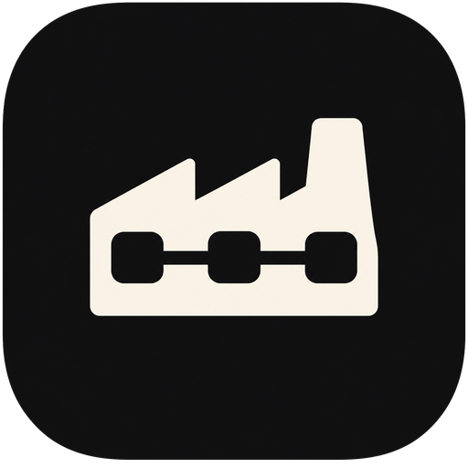

<p align="center">
  
</p>

<h1 align="center">Software Factory</h1>

<p align="center">
  <b>Turn Linear or Jira tickets into reviewed GitHub pull requests, on your own Mac, with Claude Code.</b><br />
  Spec-first, sandboxed, independently reviewed, and it never merges: you do.
</p>

<p align="center">
  <a href="https://github.com/Nikorag/Software-Factory/releases"></a>
  <a href="https://github.com/Nikorag/Software-Factory/actions/workflows/ci.yml"></a>
  <a href="LICENSE"></a>
  
  
  
</p>

---

## What it does

You label a ticket in Linear. Software Factory picks it up and does the work an engineer would, then hands you a pull request to review:

1. **Understands the ticket.** Claude reads the ticket and the code and asks you, in Linear, only if what you want is genuinely unclear.
2. **Writes a specification** with [GitHub Spec Kit](https://github.com/github/spec-kit): requirements, clarifications, a plan and tasks. A second, different model reviews it independently.
3. **Implements it** in an isolated git worktree. Every build, lint and test run happens inside a macOS sandbox with no network.
4. **Reviews its own work twice** (a cheap independent model, then Claude), with a fix loop that is capped, then re-runs every check from scratch.
5. **Opens a pull request** with an evidence report, watches CI, and tells Linear what happened.
6. **Waits for you to merge.** It has no merge capability at all. This is enforced in code and covered by a test.

It runs locally: your code, your Claude subscription, your GitHub and Linear accounts. There is no hosted service and no API key to manage.

## Features

- **Live pipeline flow chart** for every job, showing the running step, the fix loops that were actually taken, timings and attempts.
- **Watch Claude work.** Open the full back-and-forth of any agent run (prompt, messages, tool calls and their output), live while it runs.
- **Pick tickets yourself.** Set the factory to manual mode and choose what to work on from a board of your Linear tickets, searchable by number (`418`, `JAM-418`) or title. Or leave it automatic and let labelled tickets start on their own.
- **Human in the loop.** When it needs you, it stops and tells you why. Answer in the dashboard and the job resumes with your answer.
- **GitHub or Bitbucket, per project.** Each project chooses its host: GitHub through the `gh` CLI, Bitbucket Cloud with a token (see [docs/bitbucket.md](docs/bitbucket.md)). A home project and a work project can differ.
- **Linear or Jira.** Each profile uses one: connect Linear with an API key, or Jira with an OAuth app and a mapping of its statuses and labels. Run a "home" profile on Linear and a "work" profile on Jira.
- **Profiles.** Run a "home" and a "work" factory side by side, each with its own projects, tracker, GitHub account and data.
- **Settings UI and setup wizard.** Connect your tools, add projects, set their test commands, pick models per workflow step, and set concurrency and fix-cycle limits, globally or per project. No config files to edit.
- **Independent review.** A different model reviews the work than the one that wrote it.
- **Safe by construction.** See [Safety](#safety).
- **Desktop app.** A window onto the dashboard, with a menu bar icon that shows what is running and reopens the window; the factory itself runs in the background and frees your terminal.

## Requirements

- **macOS.** Project commands run inside `sandbox-exec`; the factory refuses to run them unconfined. Linux and Windows are not supported yet.
- [Claude Code](https://docs.claude.com/claude-code), signed in with your Claude subscription (no API key).
- [GitHub CLI](https://cli.github.com) (`gh`), signed in, for GitHub projects. Several accounts are fine. Bitbucket Cloud projects use a token instead and do not need it.
- [Spec Kit](https://github.com/github/spec-kit) (`uv tool install specify-cli`).
- git, Node.js 22 or newer, and Python via [uv](https://docs.astral.sh/uv/).
- A [Linear](https://linear.app) account and a personal API key, **or** a Jira Cloud site and an Atlassian OAuth app (see [docs/jira.md](docs/jira.md)). Each profile picks one.

You do not need to check this by hand: the installer verifies every item and tells you exactly how to fix anything that is missing.

## Install

```sh
curl -fsSL https://raw.githubusercontent.com/Nikorag/Software-Factory/main/install.sh | bash
```

The installer first checks your machine and **stops before changing anything** if a requirement is missing, printing the command to fix each one. Then it downloads the latest release into `~/.software-factory/app`, installs dependencies and builds the dashboard. It needs no `sudo`, asks for no credentials and installs no login item.

Read it before you run it: `curl -fsSL <url> | less`. Preview it with `bash install.sh --dry-run`, or only check your machine with `bash install.sh --check`.

## Quick start

```sh
software-factory
```

That starts the factory in the background, opens the app window and gives you your terminal back. On first run the **setup wizard**:

1. checks Claude Code, GitHub, Spec Kit and the sandbox, and shows the fix for anything that is red;
2. connects Linear (your key is verified, then stored in your macOS keychain, never in a file) and offers to create the statuses and labels it needs;
3. adds your first project: a GitHub repository, its Linear project, and the commands that run its tests.

Then start a ticket one of two ways: in **automatic** mode, label it **`factory:enabled`** in Linear and move it to **Ready for specification**; in **manual** mode, open the **Board**, find it (search by number works) and press **Start**. A project must be fully onboarded first (Settings → Projects shows what is left). Open the app and watch it go.

The factory keeps working after you close the window, and a **menu bar icon** stays behind: it shows how many jobs are running, and one click reopens the app. Stop the factory with `software-factory shutdown` (or "Stop the Factory and Quit…" from the menu bar icon).

## How a ticket flows

| Stage | What happens | Goes wrong? |
|---|---|---|
| **Discover & check** | Picks up labelled tickets and re-reads them live | Stops if the label or status changed |
| **Requirements** | Claude analyses the ticket against the code | Asks you in Linear if it is unclear |
| **Specification** | Spec Kit writes spec, plan and tasks; an independent model reviews; deterministic checks validate | Blocking findings go to a fix step |
| **Implementation** | Claude implements in a sandboxed worktree and verifies through the sandbox | A committed secret or protected-file change stops it for you |
| **Checks & reviews** | Build, typecheck, lint, test; independent review; Claude review; final gates | Findings send the *same* Claude session back to fix, then everything re-runs |
| **Delivery** | Pushes a `factory/<ticket>` branch (never forced), opens the PR, watches CI | A failing GitHub Actions check goes back to a fix; an external check is reported to you |
| **Your merge** | Waits for you | It never merges |

Fix cycles (spec fixes, review fixes, CI fixes) share one cap, default 3. After that the job stops for you instead of looping.

## Profiles

Each profile is its own factory: its own projects, Linear workspace and key, GitHub account, data and port. They run at the same time and share nothing.

```sh
software-factory profile add work     # a new, empty profile
software-factory                      # starts every profile
```

Switch profiles from the menu in the app (or the dropdown in the dashboard). Each profile sets a default GitHub account (Settings → Workflow), which any of its projects can override.

## Configuration

Everything is in **Settings** in the app:

- **Projects**: repository, Linear binding, autonomy, and the install/build/typecheck/lint/test commands. Run *Clone*, *Validate*, *Run checks* and *Onboard Spec Kit* right from the editor.
- **Workflow**: ticket pickup (automatic or manual), concurrent jobs, the fix-cycle limit, and which model handles each part of the workflow (triage, specification, implementation, independent review, Claude review). Any project can override these.
- **Integrations**: live status of every tool, and your issue tracker: Linear (API key) or Jira (OAuth app, plus mapping its statuses and labels to existing ones).
- **Profiles**: add and manage them.

Your settings live in `~/.software-factory/config/` as plain YAML, edited with comments preserved, so you can also edit them by hand. See [docs/configuration.md](docs/configuration.md).

## Command line

| Command | |
|---|---|
| `software-factory` | Start everything in the background and open the app |
| `software-factory shutdown` | Stop the background factory (all profiles, or `--profile <name>`) |
| `software-factory status` | What is running, and what it is doing |
| `software-factory profile list\|add\|remove` | Manage profiles |
| `software-factory update [--check\|--wait\|--force]` | Update to the newest release (stops, backs up and restarts the factory for you) |
| `software-factory doctor` | Check your tools and configuration |
| `software-factory jobs` | List jobs |
| `software-factory job:retry <id>` / `job:cancel <id>` | Retry or cancel a job |
| `software-factory pause` / `resume` / `stop` | Pause new work, resume, or emergency-stop (terminates running agents) |
| `software-factory serve` | Run one profile in the foreground (for debugging) |

Everything else: `software-factory --help`.

## Safety

The factory runs AI-written code, so it is built to be boringly cautious. In short (details in [SECURITY.md](SECURITY.md)):

- **It can only raise pull requests.** The GitHub client has no merge method, asserted by a test. It only pushes `factory/*` branches and never forces.
- **Project code is sandboxed.** Install, build, test and lint run under macOS `sandbox-exec`: no network (except dependency install), writes confined to the worktree, no access to your credentials.
- **Agents are fenced in.** Each role gets only the tools it needs, scoped to its worktree. Secrets never reach them, and the factory re-checks every diff afterwards for protected files (`.git`, `.env`, keys, CI workflows, agent instructions) and for secrets anywhere in branch history.
- **Everything is durable.** State is in SQLite; stages are idempotent. Stop it or crash it at any point and it resumes safely.
- **The dashboard is local.** It binds to `127.0.0.1` only, checks Host and Origin, serves a strict content-security policy, and renders all ticket and agent text as inert text. See [ADR 0007](docs/adr/0007-tokenless-dashboard.md) for the one trade-off: other processes on your machine can use it, so run it on a machine you alone use.
- **An emergency stop** terminates running agents immediately.

## Updating and uninstalling

```sh
software-factory update --check   # is there a newer release?
software-factory update           # install it (your settings and data are untouched)
software-factory update --wait    # jobs are running: update as soon as they finish (--force: now, redoing their stage)
```

`update` refuses while jobs are running (use `--wait` or `--force`). Otherwise it stops every running profile (and the LaunchAgent, if you installed one), backs up each profile's database to `<data dir>/database/backups/` (the newest 5 are kept), installs the new version, and starts again exactly what was running. If installing fails it rolls back to the version you had and reinstalls that; if it is interrupted, the next `software-factory update` finishes the job rather than reporting "up to date".

The `software-factory` command, the LaunchAgent and the app's "Start all profiles" all run the install through `~/.software-factory/app/bin/factory`, which uses the Node.js the install was built with (recorded in `app/node_modules/.factory-node`), so switching Node with nvm or upgrading it with Homebrew does not break them. If the recorded Node is gone, the factory uses the `node` on your PATH and rebuilds its SQLite module for it once, automatically. Set `FACTORY_NODE=/path/to/node` to choose one yourself.

The app shows a notice when a newer release exists. To uninstall, run `software-factory shutdown`, then delete `~/.software-factory/app` and `~/.local/bin/software-factory`. Your data stays in `~/.software-factory` until you delete it.

## Development

```sh
git clone https://github.com/Nikorag/Software-Factory.git && cd Software-Factory
pnpm install
pnpm web:build              # build the dashboard (web/dist)
pnpm factory serve          # run the default profile in the foreground
pnpm web:dev                # dashboard dev server on :5173, proxying a running `serve`
pnpm typecheck && pnpm lint && pnpm test
```

| Path | |
|---|---|
| `src/` | The factory: engine, agents, Linear, GitHub, Spec Kit, sandbox, service, API (TypeScript) |
| `web/` | The dashboard: React, Tailwind and [shadcn/ui](https://ui.shadcn.com), built with Vite |
| `desktop/` | The Electron app window |
| `config/` | Shipped, generic defaults (your own settings live in `~/.software-factory/config`) |
| `docs/` | Guides and architecture decision records |

`pnpm factory simulate` runs the whole pipeline in memory with no side effects. See [ARCHITECTURE.md](ARCHITECTURE.md) and [CONTRIBUTING.md](CONTRIBUTING.md).

## Documentation

[Setup](docs/setup.md) · [Configuration](docs/configuration.md) · [Workflows](docs/workflows.md) · [Model routing](docs/model-routing.md) · [Integrations](docs/integrations.md) · [Jira](docs/jira.md) · [Bitbucket](docs/bitbucket.md) · [Operations](docs/operations.md) · [Troubleshooting](docs/troubleshooting.md) · [Decisions](docs/adr)

## License

[ISC](LICENSE)
